# Decoded

**Read the fine print before it costs you.**

People sign, pay, or skip things they don't understand, and it costs them money, health and opportunities. Decoded takes a PDF (an electricity bill, lab report, loan agreement, government scheme, insurance policy, exam syllabus, or anything else) and explains what matters in plain language. Personal information is stripped out **on the server** before any text reaches the AI.

It is a full-3D, animation-first web app: one persistent GPU particle world sits behind the whole site and reshapes itself as you scroll, and results are an interactive experience rather than a wall of cards.

> Informational summaries only. Not legal, financial or medical advice. Always check the original document.

---

## Contents

1. [Highlights](#highlights)
2. [Quick start](#quick-start)
3. [System architecture](#system-architecture)
4. [User journey](#user-journey)
5. [The analysis pipeline](#the-analysis-pipeline)
6. [Privacy pipeline](#privacy-pipeline)
7. [Streaming protocol](#streaming-protocol)
8. [Client state machine](#client-state-machine)
9. [Supported documents](#supported-documents)
10. [Deterministic maths vs. AI](#deterministic-maths-vs-ai)
11. [Interactive results](#interactive-results)
12. [The 3D particle world](#the-3d-particle-world)
13. [Error handling](#error-handling)
14. [Project structure](#project-structure)
15. [Testing](#testing)
16. [Deployment (Vercel)](#deployment-vercel)
17. [Accessibility and performance](#accessibility-and-performance)
18. [Limits and known limitations](#limits-and-known-limitations)
19. [Tech stack](#tech-stack)

---

## Highlights

| Area | What you get |
| --- | --- |
| **Understanding** | Plain-language summary, key facts, dates, charges, clauses, warnings, next steps and what's missing, adapted to the document type. |
| **Privacy** | Server-side text extraction, typed-placeholder redaction, fail-closed verification. The original PDF is never sent to the AI. No database, no accounts, no stored files. |
| **Trust** | Maths (comparisons, loan totals, lab range checks, what-if bills) is computed in code, never by the AI. Every AI answer is schema-validated server-side and again in the browser. |
| **Experience** | Morphing GPU particle world with a pointer-driven fluid simulation, a 3D flythrough of results, a WizTree-style treemap of where a bill's money goes, a what-if simulator, and a document X-ray that pins every finding to the original page. |
| **Honesty** | Real stage-by-stage progress (no fake percentages). Sample data is always labelled and never shown in place of a failed analysis. |

---

## Quick start

**Requirements:** Node.js 22+, npm, a Gemini API key.

```bash
npm install                       # also copies the pdf.js worker into public/ (postinstall)
cp .env.example .env.local        # then fill in the two values
npm run dev                       # http://localhost:3000
```

### Environment variables

| Variable | Required | Purpose |
| --- | --- | --- |
| `GEMINI_API_KEY` | yes | Server-side only. Never prefixed with `NEXT_PUBLIC_`, never sent to the browser. |
| `GEMINI_MODEL` | yes | A model id your key can use (for example `gemini-2.5-flash`; check the [models list](https://ai.google.dev/gemini-api/docs/models)). Deliberately **not** hardcoded. |

Without them the site still loads: uploading returns a clear "AI not configured" message and the labelled simulated samples are available.

### Commands

```bash
npm run dev            # development server
npm run build          # production build
npm start              # run the production build
npm run lint           # ESLint
npm run typecheck      # tsc --noEmit
npm test               # Vitest: unit, handler and component tests (Gemini mocked, no credits needed)
npx playwright install chromium   # once
npm run test:e2e       # Playwright, desktop + mobile (Gemini responses mocked)
npm run sample-pdf     # regenerate public/sample-electricity-bill.pdf (fictional data)
```

---

## System architecture

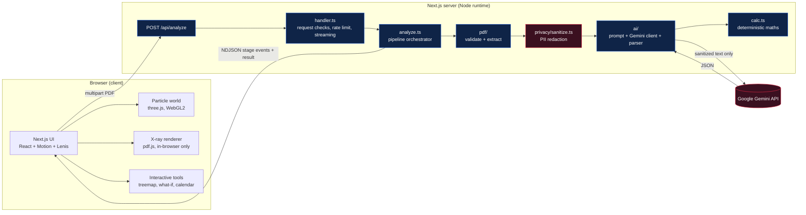

**Key boundaries**

- The browser only ever talks to `/api/analyze`. The Gemini key lives on the server.
- Raw extracted text never leaves `analyze.ts`; only the sanitized text goes to Gemini.
- The X-ray view redraws the original PDF **in the user's browser**; it is not uploaded anywhere new.

---

## User journey

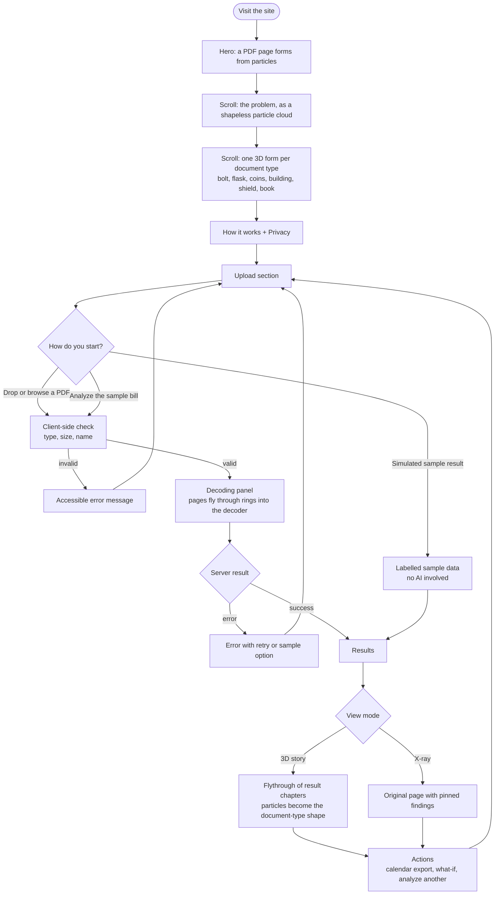

---

## The analysis pipeline

Everything between "file received" and "validated result" runs in `lib/handler.ts` and `lib/analyze.ts`. Each box maps to a module.

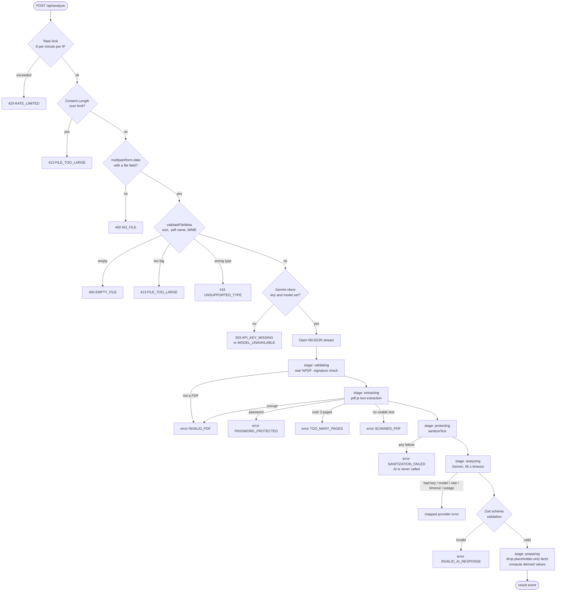

> Failures **before** the stream opens return a normal HTTP status. Failures **inside** the stream arrive as a single `error` event (the HTTP status is already 200) and carry the same user-facing message and `retryable` flag.

---

## Privacy pipeline

The sanitizer (`lib/privacy/sanitize.ts`) is the most important safety component. It is **fail-closed**: if anything goes wrong, analysis stops and nothing is sent to the AI.

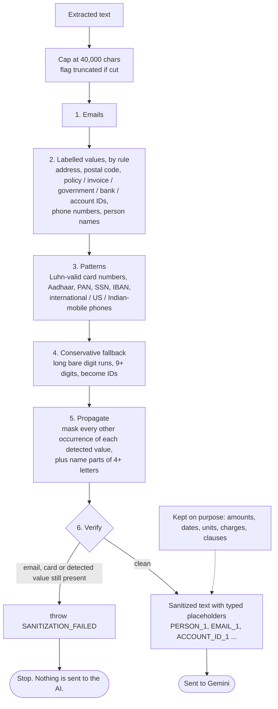

Example:

| Before | After |
| --- | --- |
| `Customer Name: Rahul Sharma` | `Customer Name: [PERSON_1]` |
| `Email: rahul@example.com` | `Email: [EMAIL_1]` |
| `Consumer Number: 1234567890` | `Consumer Number: [ACCOUNT_ID_1]` |
| `Total Payable: Rs 2,450.00` | `Total Payable: Rs 2,450.00` (unchanged) |

The placeholder map never leaves the sanitizer and is never restored in the UI. The model is also told to treat the document as **untrusted data** and ignore any instructions inside it (prompt-injection defence), and not to list placeholders as facts.

---

## Streaming protocol

Analysis can take several seconds, so the server streams newline-delimited JSON. The UI shows the stage the server actually reports, with no timers or fake percentages.

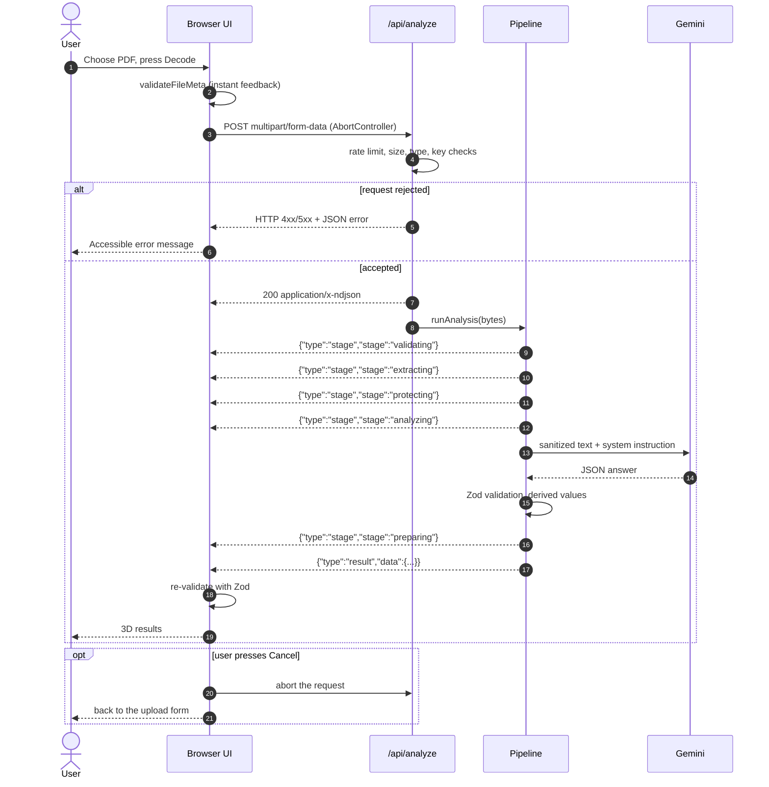

---

## Client state machine

`components/Analyzer.tsx` owns one small state machine. It also tells the 3D world what to do for each state.

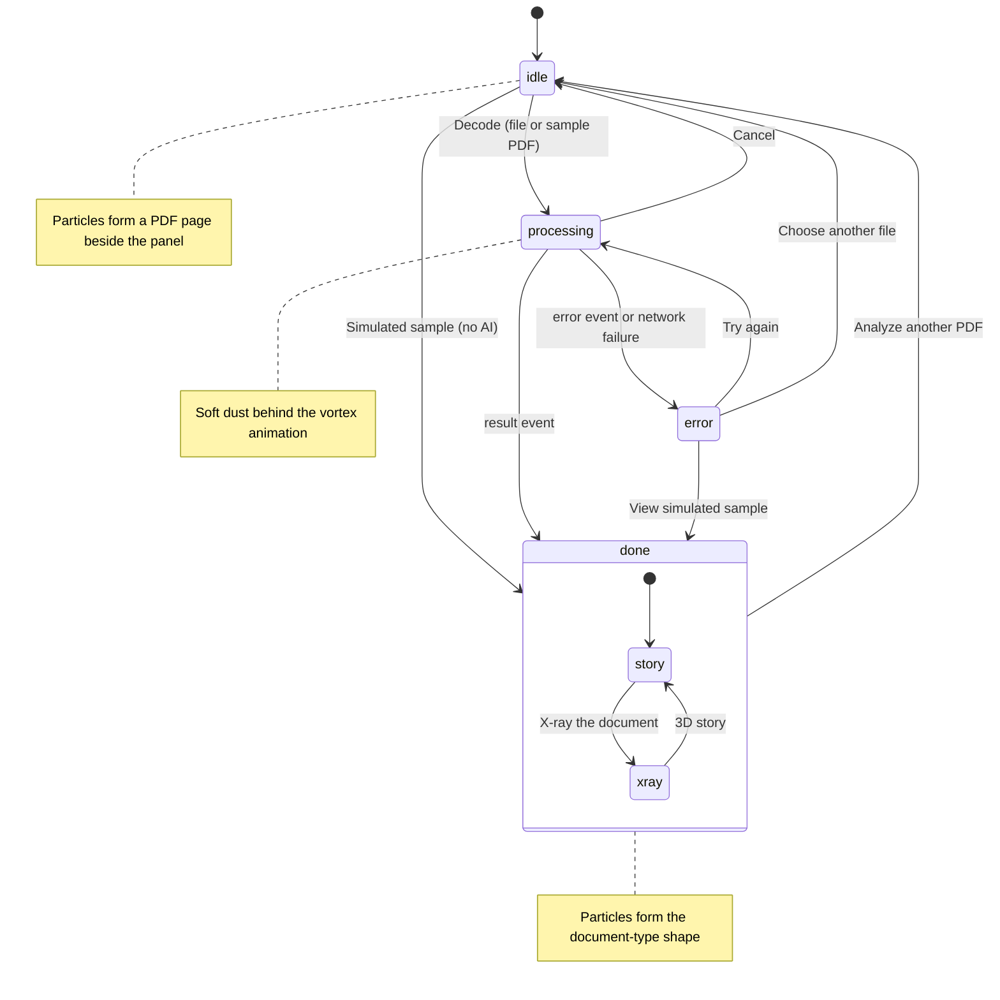

---

## Supported documents

The model picks a category and **never forces** an unknown document into one (it falls back to `other`). Each category unlocks its own sections.

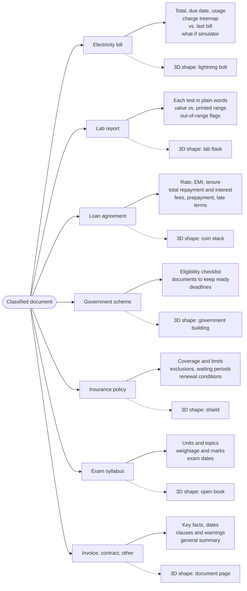

Rules baked into the prompt:

- **Lab reports:** copy values, units and ranges exactly as printed; explain what each test measures; never diagnose or suggest treatment.
- **Government schemes:** list each criterion separately; never decide whether the reader qualifies.
- **Contracts, loans, insurance:** informational summary only; only suggest actions the document itself supports.
- **Everywhere:** use only what the text supports, omit what isn't stated, and list gaps under "missing information".

---

## Deterministic maths vs. AI

The AI reads and explains. Code does the arithmetic. This keeps numbers trustworthy.

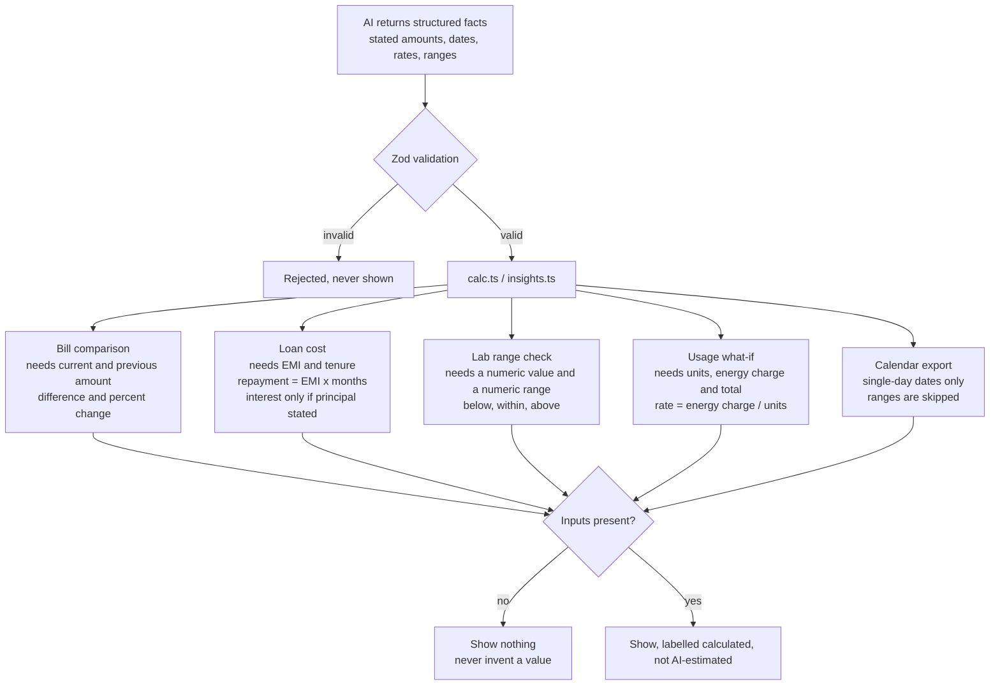

---

## Interactive results

Cards alone are what every summariser does, so results have two views.

### 3D story

Results float out of the document as glass chapters. Scrolling flies the camera through them; each chapter has a resting zone where it sits perfectly flat and sharp. A side navigation jumps between chapters. Long chapters scroll inside their own frame.

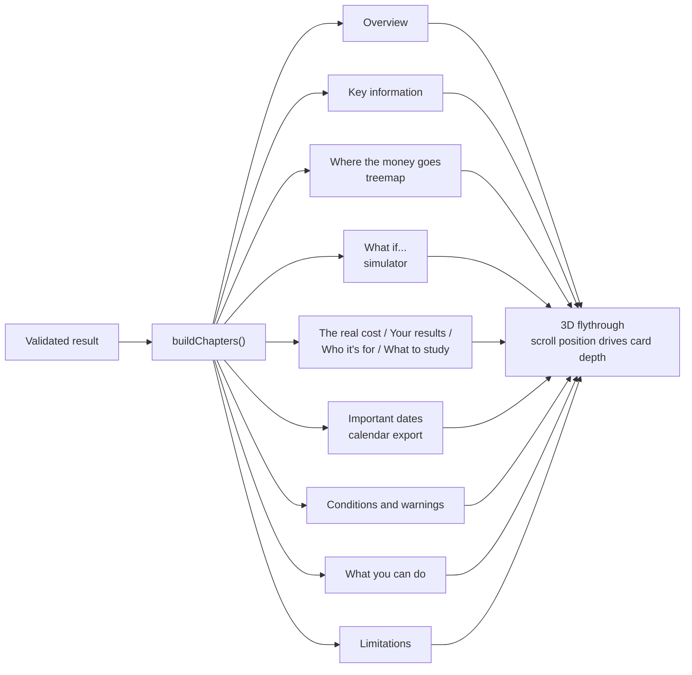

Empty sections are hidden, never shown blank.

### Bill treemap and what-if simulator

- **Treemap:** every charge is a block sized by its share of the bill (squarified layout), with a headline like "Energy Charges takes 72% of your bill". Tap a block for its plain-English meaning.
- **What-if:** drag the units slider and watch the bill recalculate from the bill's own rate. Presets for -25%, -10%, as billed and +20%. It only appears when the bill states consumption, an energy charge and a total, and it says plainly that it is an estimate.

### X-ray: "show me where it says that"

The original PDF is rendered in the browser and every finding is pinned to the exact text on the page. Hover or tap a highlight for its explanation; click a finding in the list to jump to it.

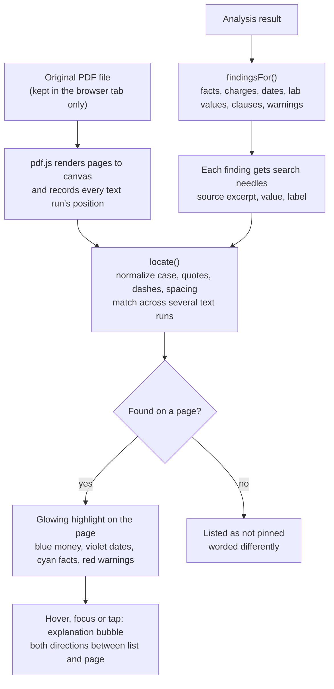

Needles that contain privacy placeholders are never used. The X-ray is available when the original PDF is known (a file you uploaded, or the sample bill).

---

## The 3D particle world

One persistent GPU particle system (about 65k particles on desktop, 37k on tablet, 16k on phones) sits behind the whole page. Sections tell it what to become through a tiny shared store.

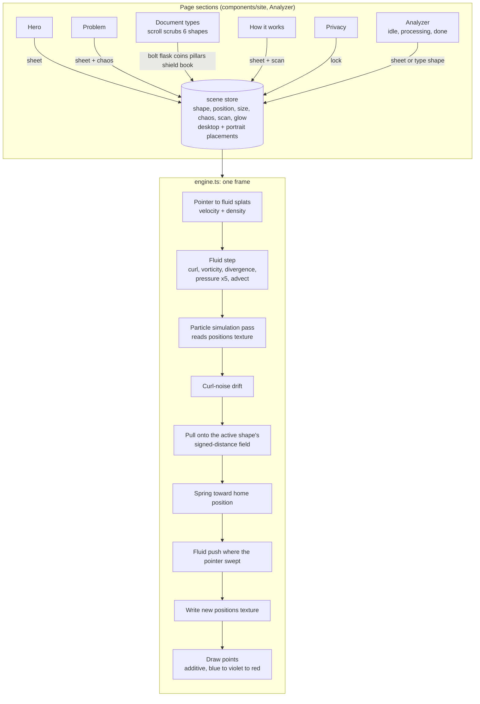

How it stays fast and safe:

- Particle positions live in a float texture and are updated by a fullscreen shader pass, so the CPU does almost nothing per frame.
- One tiny shader program per shape, compiled in the background after the intro, so the first morph doesn't stutter.
- Pauses when the tab is hidden; disposes all GPU resources on unmount; pixel ratio capped at 1.75.
- No WebGL2 or float render targets: a soft static gradient is shown and the site works identically.
- `prefers-reduced-motion`: the world settles once per section and stops animating; scroll-linked sequences become static content.
- Lenis smooth scrolling is turned off for touch devices and reduced-motion users.

---

## Error handling

Every failure has a code, an HTTP status (when raised before streaming), a plain message and a `retryable` flag. Messages never include stack traces, prompts, keys or document content, and logs record error codes only.

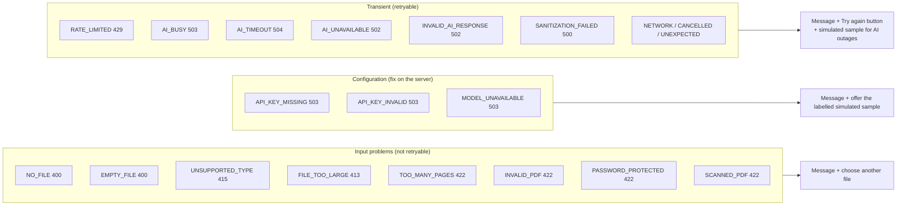

Provider mapping: HTTP 429 becomes `RATE_LIMITED`, 503 becomes `AI_BUSY`, 404 becomes `MODEL_UNAVAILABLE`, 401/403 or a 400 mentioning the API key becomes the key errors, and an abort or 408/504 becomes `AI_TIMEOUT`. Anything else is `AI_UNAVAILABLE`.

The app **never silently replaces** a failed analysis with fake data. The simulated sample is only ever offered, always labelled, and never presented as AI output.

---

## Project structure

```text
decoded/
├── app/
│   ├── api/analyze/route.ts      # Node-runtime route, thin wrapper over lib/handler
│   ├── layout.tsx                # fonts, Lenis, film grain, skip link
│   ├── page.tsx                  # section order + scene canvas
│   └── globals.css               # design tokens, liquid glass, utilities
├── components/
│   ├── scene/                    # persistent 3D world
│   │   ├── engine.ts             #   GPU particles + fluid simulation + SDF shapes
│   │   ├── store.ts              #   shapes and the section-to-scene store
│   │   └── SceneCanvas.tsx       #   mounts the engine, handles fallback
│   ├── site/                     # landing sections
│   │   ├── Hero.tsx  Problem.tsx  DocumentTypes.tsx
│   │   ├── InfoSections.tsx      #   how it works, privacy
│   │   ├── CtaFooter.tsx         #   HLS video CTA + footer
│   │   └── motion.tsx            #   MaskWords, Reveal
│   ├── results/
│   │   ├── ResultsView.tsx       # 3D flythrough + all chapters
│   │   ├── MoneyTreemap.tsx      # WizTree-style charge map
│   │   ├── UsageSimulator.tsx    # what-if bill
│   │   └── XRayView.tsx          # findings pinned on the original page
│   ├── reactbits/                # BlurText, ShinyText, CountUp (vendored React Bits)
│   ├── Analyzer.tsx              # state machine for upload / decode / results
│   ├── UploadArea.tsx  ProcessingState.tsx  DocumentVortex.tsx
│   ├── ErrorMessage.tsx  Navigation.tsx  LenisProvider.tsx
├── lib/
│   ├── handler.ts                # request checks, rate limit, NDJSON stream
│   ├── analyze.ts                # the pipeline orchestrator
│   ├── pdf/                      # validate.ts, extract.ts
│   ├── privacy/sanitize.ts       # PII detection and redaction
│   ├── ai/                       # prompt.ts, gemini.ts (client, errors, parser)
│   ├── calc.ts                   # comparison, loan cost, lab ranges
│   ├── insights.ts               # treemap layout, what-if, .ics, X-ray matching
│   ├── client.ts                 # browser NDJSON reader + re-validation
│   ├── errors.ts  config.ts  rate-limit.ts  sample.ts
├── types/analysis.ts             # Zod schema + shared types
├── tests/                        # Vitest + Testing Library + Playwright e2e
├── scripts/                      # sample PDF generator, pdf.js worker copy
└── public/                       # sample-electricity-bill.pdf, pdf.worker.min.mjs
```

Central limits live in one place, `lib/config.ts`:

| Setting | Value |
| --- | --- |
| Max file size | 5 MB |
| Max pages | 3 |
| Max text sent to AI | 40,000 characters (truncation is disclosed) |
| Minimum text per page | 40 characters (below this is treated as a scan) |
| Gemini timeout | 45 seconds |
| Rate limit | 6 requests per minute per IP (in-memory) |
| Route max duration | 60 seconds |

---

## Testing

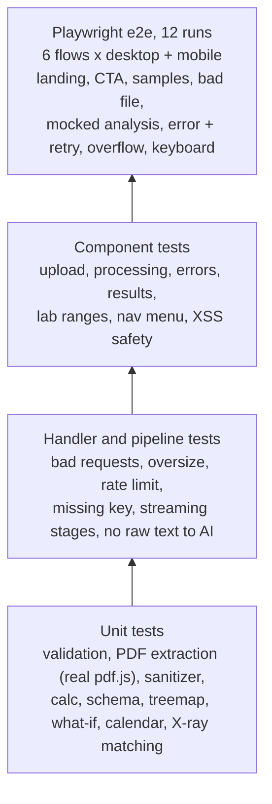

- **58** Vitest tests run in about a second or two, with Gemini mocked so no credits are needed.
- **12** Playwright runs (6 flows, desktop and Pixel 5 mobile) use a mocked analysis response for determinism.
- Notable guarantees under test: the sanitizer runs **before** the AI call; sanitization failure means the AI is never called; invalid AI output is rejected; AI text is rendered as text, never HTML; comparisons, loan totals and range checks never appear without their inputs.

Live Gemini was verified separately by running the bundled sample bill end to end.

Manual checklist: widths 320, 375, 390, 430, 768, 1024, 1280, 1440, 1920 with no horizontal scroll and a working menu; tab through nav, upload and results with visible focus; toggle OS "reduce motion"; try a non-PDF, a file over 5 MB, over 3 pages, a password-protected PDF, a scanned PDF, a missing API key, and cancelling mid-analysis.

---

## Deployment (Vercel)

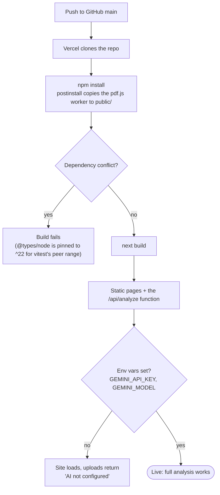

Checklist:

1. Set `GEMINI_API_KEY` and `GEMINI_MODEL` under **Project → Settings → Environment Variables** (Production). `.env` files are git-ignored, so Vercel can't see your local ones.
2. The analyze route needs the **Node.js runtime** (not Edge) because of pdf.js. `pdfjs-dist` is listed in `serverExternalPackages` in `next.config.ts`.
3. The route requests up to 60 seconds (`maxDuration`). The free Hobby plan caps functions at that, and the Gemini call times out at 45 seconds, so it fits, but a slow model response can still fail.
4. The in-memory rate limiter is per instance. On serverless it only slows casual abuse; use a shared store (for example Redis/Upstash) or platform rate limiting for anything public.
5. The HLS background video in the footer streams from Mux and loads only when the footer is near the viewport.

---

## Accessibility and performance

- Semantic headings and landmarks, skip link, visible focus rings, labelled controls, `aria-live` stage updates, and `role="alert"` errors.
- Animated headings keep real text for screen readers; animated numbers keep the final value available to assistive tech.
- Every interactive tool (treemap blocks, X-ray highlights, sliders, view switch, chapter list) is keyboard-operable.
- Mobile-first layout with no horizontal overflow at 320 px, touch-sized controls, and phone-specific particle placement.
- Heavy work stays off the main thread where possible: particle simulation on the GPU, pdf.js text extraction on the server, X-ray rendering lazily loaded only when you open that view.

---

## Limits and known limitations

- **PDF only**, text-based: 5 MB, 3 pages. **Scanned PDFs are not supported** (no OCR yet).
- **PII detection is heuristic.** It can miss names that aren't labelled, unusual ID formats and non-English labels, and can occasionally over-redact. Don't upload highly sensitive documents. Decoded makes no claim of anonymity.
- **AI output is validated for shape, not truth.** Summaries can be wrong. Users are told to check the original.
- **Lab results** are explained, not diagnosed. **Government schemes**: criteria are listed, eligibility is not decided. **Loans, contracts, insurance**: informational only.
- **What-if bills** assume non-energy charges stay fixed; usage-linked charges (duty, fuel adjustment) may move too. It is labelled an estimate.
- **X-ray** pins a finding only when its text can be located on the page; reworded findings appear in the list as "not pinned". It shows up to the first 3 pages.
- Calendar export includes only single-day dates; date ranges are skipped.
- Structured output uses Gemini's JSON mode plus Zod validation rather than a response schema, for model compatibility. Invalid output is rejected, not shown.
- The rate limiter is in-memory and per instance (see Deployment).
- Free-tier Gemini keys have low request-per-minute quotas; "Too many requests" means wait a minute or try a lighter model.

---

## Tech stack

| Layer | Choice |
| --- | --- |
| Framework | Next.js (App Router), React, TypeScript (strict) |
| Styling | Tailwind CSS 4; Instrument Serif and Barlow; custom liquid-glass utilities |
| 3D and motion | three.js (GPU particles and fluid), Motion for React, Lenis, React Bits (`BlurText`, `ShinyText`, `CountUp`) |
| Video | hls.js (footer background stream) |
| AI | Google Gemini via `@google/genai`, JSON mode |
| PDF | `pdfjs-dist` (server extraction and in-browser X-ray) |
| Validation | Zod |
| Tests | Vitest, React Testing Library, Playwright |
| Icons | Lucide |

Brand palette: Obsidian `#050505`, Electric Blue `#2563EB`, Neon Red `#FF304F`, blended through violet.
